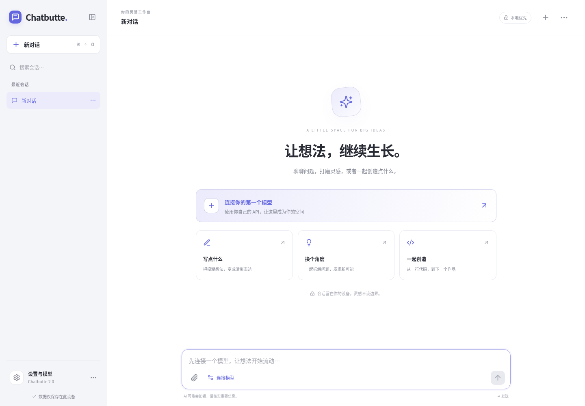

# Chatbutte 2

**一个安静、可靠、本地优先的 AI 对话工作台。**

A calm, local-first workspace for conversation and creation.

[在线使用](https://liuxl.com.cn/chatbutte/) · [功能审计与重构决策](docs/PRODUCT-AUDIT.md) · [架构](docs/ARCHITECTURE.md) · [迁移](docs/MIGRATION.md) · [部署与安全](docs/DEPLOYMENT.md)

Chatbutte 2 是从空目录重新实现的版本，不是旧版换皮。前端、状态与存储、模型请求、流式处理、服务端和测试均已重建；旧版代码不参与新版运行。保留 Chatbutte 的产品定位和用户数据兼容边界。



## 能做什么

- **多模型**：自带 API，管理多个 OpenAI Chat Completions 兼容配置；按会话切换模型，对话与生图明确区分。
- **可靠生成**：流式正文、独立思考内容、`<think>` 兼容显示、停止、保留部分结果、明确报错与重新生成。支持非流式 JSON 上游回退。不会自动重试付费生成。
- **完整对话工具**：会话搜索、置顶、排序调整、重命名、系统提示词、上下文消息数与温度、上下文分段、清空、删除、编辑历史用户消息并重新发送。
- **阅读与输入**：安全 Markdown、GFM 表格、代码高亮和代码复制；上滑阅读时不强行追底；每个会话独立草稿；图片粘贴、拖放及文本附件。
- **本地优先**：IndexedDB 保存会话、草稿和附件，不再因刷新主动删掉图片或截断文本；写入失败可见，多标签页只允许一个写入者。
- **备份与迁移**：旧版 localStorage 自动迁移，JSON 导入先验证再替换，替换前保留恢复点；普通导出默认排除 API 密钥。
- **手动云端备份**：自己的私密 GitHub Gist，检测远端变化并确认覆盖，上传不含密钥和 Token。不会自动上传。
- **文生图**：OpenAI Images、DashScope 同步多模态图片接口，图片预览与保存。
- **一个界面，两种屏幕**：桌面侧栏、手机抽屉；手机全屏设置；浅色/深色/跟随系统，中英切换，可添加到主屏幕。

### 明确的边界

- 原生 Responses、Anthropic Messages、Gemini、工具调用、异步生图、参考图编辑和 PDF 解析**不在本版支持范围**；可以接入提供 Chat Completions 兼容接口的网关。
- 最多 5 个附件；单图 4 MiB（PNG/JPEG/WebP/GIF），单文本 512 KiB。不接受“看起来上传成功，实际只发送文件名”的二进制附件。
- 旧版已经删除的图片或截断的文本无法恢复；迁移后会标记。供应商图片 URL 可能过期，重要图片应及时保存。
- 安装到主屏幕不代表离线 AI；本版没有 Service Worker，也不缓存模型请求。
- 浏览器数据不等于永久存档；清理网站数据、无痕模式、设备损坏均可导致丢失，请定期备份。

## 本地运行

开发、构建与测试要求 Node.js **22.12+**（本机验证为 Node 24）；构建后的生产网关支持 Node **20.18+**。首次安装需要 npm 网络访问。

```bash
npm ci
npm run build
npm start
# http://127.0.0.1:8080
```

开发时分别运行：

```bash
npm run dev:server
npm run dev
# Vite 默认地址 http://127.0.0.1:5173
```

Vite 将 `/api` 代理到本地 Node 服务。生产只服务 `dist/`，不公开源码目录。

## 配置模型

1. 点击「连接你的第一个模型」或「设置与模型」。
2. 选择对话或生图，填写显示名称、模型 ID、API 地址及可选 API Key。
3. 地址可以是基础地址（如 `https://api.example.com/v1`），也可以是完整标准端点。
4. 思考控制默认不发送额外字段；若开启/关闭，需选择供应商支持的控制格式，避免同时发送多套互相冲突的参数。
5. 模型不支持温度时，关闭「发送温度参数」。

**桌面**：可选 Enter、⌘/Ctrl+Enter、Ctrl+Enter、Alt+Enter；Shift+Enter 始终换行，输入法选词不发送。

**手机/触屏**：Enter 换行，点击发送按钮；显式组合快捷键仍按设置处理。

## 隐私不是一句“纯前端”

- 会话与凭据保存在**当前浏览器**，服务端没有聊天数据库。
- 模型 API Key 和 Gist Token 在浏览器中**未加密**保存。不要在不可信或共享设备上留存。
- 对话、附件和模型密钥会经过**部署这个应用的服务器**，再发给你配置的服务商。因此部署者必须可信。
- Gist 仅在手动操作时接收备份；上传字段白名单排除凭据。私密 Gist **不是端到端加密**。
- 生成图片或 Markdown 里的远程图片可能直接从第三方加载。
- JSON 导出默认不含密钥；勾选包含密钥的备份应视为敏感文件。Gist Token 从不导出。

## 验证

```bash
npm run build         # TypeScript + production build
npm test              # domain/migration/SSE + actual HTTP/server tests
npx playwright install chromium  # 没有系统 Chromium 时
npm run test:e2e      # desktop + touch/mobile Chromium
npm run format:check
npm audit --omit=dev
```

测试使用假密钥、本地流和供应商/Gist fixtures，**不会调用付费模型或真实 Gist**。覆盖正常使用及多标签页、坏备份、存储写入失败、取消、持续流检查点、SSRF 地址校验、背压取消、并发限制等。自动化手机测试不代替 iPhone/Android 真机验收。`deploy/github-actions.example.yml` 是可选 CI 模板；当前仓库凭据缺少 workflow scope，因此没有擅自启用 Actions，具备权限后可复制到 `.github/workflows/ci.yml`。

## 部署

见 [docs/DEPLOYMENT.md](docs/DEPLOYMENT.md)。默认监听 `127.0.0.1:8080`。公网反代必须配置 `CHATBUTTE_ORIGINS`，并设置访问密码或明确启用公开模式。不要把未配置的开发服务直接暴露到公网。

## English overview

Chatbutte 2 is a **clean-room implementation**, not an incremental reskin of the previous app. It uses React + TypeScript, versioned IndexedDB storage, and a small Node streaming gateway.

Bring your own OpenAI-compatible chat models or synchronous image endpoints. Enjoy persistent per-conversation drafts and attachments, safe Markdown/code rendering, reasoning, cancellation, retries, context boundaries, search/pins, validated backups, legacy migration, and optional manual secret-Gist backups. Desktop and touch layouts share one component tree.

Keys live unencrypted in your browser and transit your deployment’s gateway to your provider. Standard exports and all Gist uploads exclude credentials. This is local-first, **not** end-to-end encrypted. No automatic cloud uploads, no provider billing calls in tests, and no promise of offline AI.

MIT · Abel Liu
